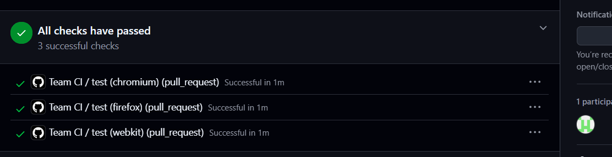
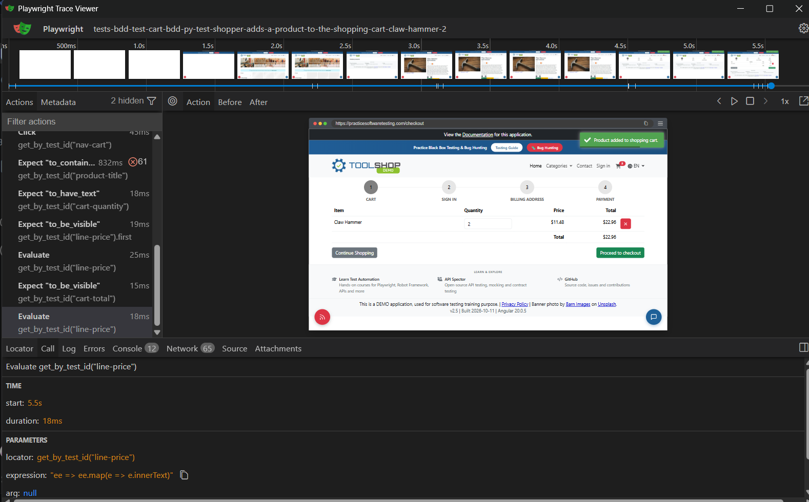

# Toolshop Automation Team HH

**Automation Testing Project – Sprint 1 & Sprint 2**


Dự án kiểm thử tự động website Toolshop, sử dụng Python, Pytest, Playwright và BDD. Dự án được xây dựng nhằm kiểm thử các luồng nghiệp vụ, API và giao diện người dùng, đồng thời tích hợp GitHub Actions để tự động chạy kiểm thử trên nhiều trình duyệt.

## 1. Technologies

- Python 3.12
- Pytest
- Playwright
- pytest-bdd (BDD / Gherkin)
- pytest-html (HTML Test Report)
- pytest-xdist (Parallel Testing)
- pytest-rerunfailures
- Docker Compose
- GitHub Actions

## 2. Project Structure

```text
toolshop-automation-team_HH/
│
├── .github/
│   └── workflows/
│       └── ci.yml
│
├── data/
│
├── pages/
│   ├── base_page.py
│   ├── home_page.py
│   ├── product_page.py
│   └── cart_page.py
│
├── tests/
│   ├── api/
│   │   └── test_api_sprint2.py
│   │
│   ├── bdd/
│   │   ├── features/
│   │   │   └── cart.feature
│   │   └── test_cart_bdd.py
│   │
│   └── ui/
│       ├── test_network.py
│       ├── test_smoke.py
│       └── test_sprint2.py
│
├── toolshop/
│   ├── docker-compose.yml
│   ├── nginx.conf
│   └── start.sh
│
├── conftest.py
├── pytest.ini
├── requirements.txt
├── .env.example
└── README.md
```

## 3. Testing Scope

### API Testing
- Verify API status and response structure.
- Validate product search functionality.
- Test authentication and authorization.
- Verify API error responses.

### UI Testing
- Test product searching and filtering.
- Verify product details.
- Test shopping cart functionality.
- Test user authentication.
- Test contact form.
- Verify application behavior under network conditions.

### BDD Testing

Using Gherkin syntax and pytest-bdd to describe business scenarios.

**Shopping Cart Feature:**
- Add a product to the shopping cart.
- Select product quantity.
- Verify the line price.
- Verify the cart total.

Example:

```gherkin
Scenario Outline: Shopper adds a product to the shopping cart
  When I open the product "<product>"
  And I add it to the cart with quantity <quantity>
  Then the cart line price should equal the unit price multiplied by <quantity>
  And the cart total should equal the sum of line prices

Examples:
  | product            | quantity |
  | Combination Pliers | 1        |
  | Claw Hammer        | 2        |
```

## 4. Running Tests Locally

### Install dependencies

```bash
pip install -r requirements.txt
playwright install
```

### Configure environment

Copy `.env.example` to `.env` and configure the required environment variables.

Do not commit `.env` or any sensitive credentials.

### Start Toolshop

Docker Desktop and Docker Compose are required.

Using Git Bash or WSL:

```bash
bash toolshop/start.sh
```

### Run BDD tests

```bash
pytest tests/bdd -v
```

### Run the full test suite

```bash
pytest
```

## 5. Continuous Integration – GitHub Actions

The project integrates GitHub Actions to automatically execute the full test suite.

### Workflow Triggers

- Push to `main`.
- Pull Request targeting `main`.
- Manual execution using `workflow_dispatch`.

### Browser Matrix

The CI pipeline executes tests independently on three browsers:

| Browser | Job |
|---|---|
| Chromium | test (chromium) |
| Firefox | test (firefox) |
| WebKit | test (webkit) |

The workflow uses `fail-fast: false`, allowing the remaining browser jobs to continue even if one job fails.

### Test Execution

- Run the complete test suite.
- Execute tests using 2 parallel workers.
- Retry failed tests once.
- Capture Playwright traces on failure.
- Capture screenshots on failure.
- Generate self-contained HTML reports.

### Test Artifacts

Each browser uploads its own artifacts:

- `test-results-chromium`
- `test-results-firefox`
- `test-results-webkit`

Each artifact contains the HTML report and available test results and traces.

## 6. CI Execution Evidence

### GitHub Actions – All Browsers Passed

The following screenshot demonstrates a successful CI execution across Chromium, Firefox and WebKit.



### Playwright Trace Viewer

Trace Viewer is used to inspect failed test executions, including browser actions, screenshots, DOM snapshots and network activity.



## 7. Pull Request and Branch Protection

The `main` branch is protected to maintain code quality.

Required conditions:

- Changes must be submitted through Pull Requests.
- At least one approving review is required.
- Chromium status check must pass.
- Firefox status check must pass.
- WebKit status check must pass.
- Direct changes to `main` are restricted by branch protection rules.

## 8. Team Workflow

1. Create a feature branch.
2. Implement tests and update the necessary files.
3. Run tests locally.
4. Commit and push changes.
5. Create a Pull Request targeting `main`.
6. Wait for GitHub Actions to complete.
7. Request code review and obtain approval.
8. Merge only when all required checks pass.

---

**Project:** toolshop-automation-team_HH  
**Repository:** https://github.com/HuynhHuy11111/toolshop-automation-team_HH  
**CI:** GitHub Actions  
**Testing Framework:** Pytest + Playwright + pytest-bdd
